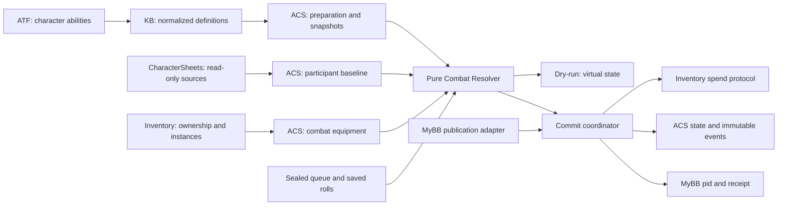

# AdvancedCombatSystem: проект Combat Resolver, этап C

## 1. Статус и основания

Архитектурное предложение для последовательной реализации D1–D12. База: `d593fda56e42337c0ebeb10de57e5e942ec086b9`, MyBB 1.8.40, PHP 8.5.0. Здесь нет реализованного ACS, новых формул баланса или разрешения исполнять legacy-описания. Предлагаемые структуры ACS и алгоритмы ниже не являются существующими PHP API. Решения владельца правил отделены в [ACS_BALANCE_DECISIONS.md](ACS_BALANCE_DECISIONS.md).

Источники фактов: [аудит A](ACS_KB_MECHANICS_AUDIT.md), [нормализация B1](ACS_KB_NORMALIZATION_CONTRACT.md), [формулы B2](ACS_KB_FORMULA_CONTRACT.md), [механики B3](ACS_KB_MECHANICS_CONTRACT.md), [ARPG-интеграция](ARPG_INTEGRATION_CONTRACT.md), [эффекты способностей](CHARACTER_ABILITY_EFFECTS_CONTRACT.md). B1–B3 уточняют первоначальный аудит; перечисление будущего helper в общем контракте не доказывает его реализацию. Отдельного прежнего плана D1–D12 в документах репозитория не найдено: раздел 17 предлагает распределение задач, которое ещё нужно принять как план реализации.

Точечные технические проверки, влияющие на проект:

- В `charactersheets/modules/calculator.php` функция `af_charactersheets_compute_sheet_view()` при наличии sheet_id вызывает синхронизацию fixed skills. Полный сборщик не подходит для read-only расчёта ACS; `cs_build_character_state()` также не является достаточной проверкой авторизации.
- В `advancedinventory/advancedinventory.php` есть экспорт `af_advinv_export_charactersheet_equipment_state()`, а также отдельные пути `af_inv_remove_item()`, sell/delete/bulk_delete. Общего контракта ACS-резерваций сейчас нет. Наличие экспорта не гарантирует нужную детализацию источников бонусов.
- ATF использует hooks datahandler_post_validate/insert_thread/update и связанные validation hooks. Это не подтверждает транзакционные границы MyBB. Исходников ядра публикации MyBB в данном репозитории нет; обязательная проверка развёрнутого ядра вынесена в D1/D11.

## 2. Ответственность и схема взаимодействия

| Компонент | Владеет | Взаимодействие с ACS |
|---|---|---|
| KB | Определения и ссылки, typed AST, статусы, предметы, монстры | Только существующий нормализованный read API; снимки перед исполнением |
| CharacterSheets | Постоянный лист и предварительные карточки | Read-only регистрационный снимок исходных данных; никакой записи боевых последствий |
| ATF | Индивидуальные параметры анкетных способностей | Через проекцию character KB; ACS не переопределяет их формат хранения |
| Inventory | Экземпляры, владение, глобальная экипировка, количества | Проверка владения; привязки и резервации; согласованный протокол списания |
| Shop и прочие потребители Inventory | Разрешённые операции с глобальными предметами | Общие серверные guards Inventory, включая обходные административные пути |
| MyBB | Посты, пользователи, форумные права и модерация | Адаптер успешной публикации и pid; текст не служит источником боевых команд |
| ACS | Сессия, участники, AP, броски, состояния, события | Единственный исполнитель боевой математики и изменений HP |



Resolver — чистый модуль: не читает БД, не вызывает KB/CS, не генерирует случайность, не пишет посты. Координаторы передают готовые снимки, состояние и броски. Один алгоритм используется для dry-run и финального вычисления; различаются режим сохранения и актуальная версия входного состояния.

## 3. Контракты ACS

Все названия ниже — предлагаемые DTO/интерфейсы, не новые функции KB. Версия каждого DTO и версия engine/numeric/ruleset policy фиксируются явно.

| Структура | Существенные поля |
|---|---|
| DefinitionRequest | type, key, abilityIndex?, ожидаемые version/fingerprint, область разрешённых записей |
| PreparedDefinition | plan_id, plan_schema, root identity, полный dependency manifest, snapshots, engine compatibility, policy_ids, diagnostics, executable |
| CombatCommand | command_id, session_id, round_id, turn_epoch, control_group_id, acting_participant_id, action_kind, sealed payload, plan_id, targets, expected_versions |
| ResolveInput | command/queue, StateSnapshot, PreparedDefinitions, RollBundle, execution policies; никаких DB handles |
| ResolveResult | success либо typed error; candidate state, ordered events, resource/item intents, inputs/outputs trace, state hash; без сохранения |
| PublicationIntent | entitlement_id, immutable queue hash, snapshots hash, roll manifest hash, preview state versions, author, thread, nonce |
| CommitReceipt | command/intent id, pid, round/group, до/после state versions, event range, committed hash |
| Error | code, stage, path, definition/participant/action identity, retryability, safe detail, correlation_id |

`executable=true` существует только у подготовленного ACS-плана после всех проверок. KB `supported=true` означает пригодность нормализации; KB `executable=false` не переключается записью в KB. Недоступные пользователю исходники и raw не попадают в HTTP-диагностику; администратор видит подробную серверную трассу.

## 4. Подготовка механики и снимки

### 4.1. Единственный вход KB

Используются именно:

```php
af_kb_arpg_read_definition(string $type, string $key, ?int $abilityIndex = null): array;
af_kb_arpg_normalize_entry(array $entry, ?int $abilityIndex = null): array;
```

Второй вариант — для уже прочитанной оригинальной строки записи, не для произвольного клиентского JSON. Типы: arpg_ability, character, arpg_item, arpg_bestiary, arpg_mechanics. `abilityIndex` — индекс исходного character_abilities[], не slot_index и не позиция после сортировки. ACS проверяет права на персонажа, управление существом, сессию и видимость записи до выдачи сведений.

Принимаются schema `af_kb.arpg.sheet-normalized.v1`, source, definition_key, definition_version, normalized, diagnostics, supported, executable и raw. Raw хранится защищённо для происхождения, но не используется как альтернативный источник исполнения. В ACS нет парсера data_json/meta_json.rules, повторного legacy-нормализатора или вызова старых проекций вместо B1.

B1 уже выбирает целую data_json-проекцию перед meta_json.rules, сообщает source_conflict и отличает отсутствие от нуля. ACS не устраняет такой конфликт выбором отдельных полей. Ошибки нормализации блокируют соответствующее действие; предупреждения допускаются лишь по явному allowlist и не восполняют обязательные правила.

### 4.2. Последовательность подготовки

1. Проверить происхождение, schema, supported и diagnostics. Inactive-запись не исполняется при подготовке новой заявки. Реальная revision может быть null — версию содержимого не выдумывать.
2. Выделить нужное определение из normalized, включая mechanics_definitions.definition. Это адаптация типизированной структуры к плану, а не повторное чтение legacy JSON.
3. Проверить capability registry ACS: тип эффекта, операция, фаза, единица времени, тип ресурса, targeting, usage limit, consumption/repeat rule и каждый другой исполняемый токен должны иметь поддержанный алгоритм. Валидная строка-токен KB сама по себе недостаточна.
4. Для эффекта потребовать однозначные цель/число попаданий, вид воздействия и механические ссылки, необходимые именно этому виду. Для вычисляемой величины нужна разрешённая formula_def либо явная поддержанная константная механика. Не создавать коэффициент из описания, профиля без формулы или seed.
5. Сохранить value_mode, hit_count, formula_ref, coefficient и прочие исходные параметры. formula_ref и formula_profile разрешать раздельно. Использовать наследование B1: допустимые поля уже унаследованы, duration/element/coefficient произвольно не добавлять. Отсутствие значения не заменять нулём. Пустая отброшенная строка не становится эффектом.
6. Раскрыть зависимости: profile → pinned formula; status/condition/resource/trigger/scaling/combat templates; предмет/способность/монстр → effect_ref; summon → bestiary. Формульный AST сам не содержит ссылок на другие формулы. Effect_ref B3 адресует исходный корневой effects[] и его индекс, не новую сущность effect_def.
7. Для каждой ссылки проверить существование, active, тип, обязательную версию, fingerprint, права использования, допустимую область и поддержку смыслов. Resource key должен разрешаться в resource_def и в хранилище ресурса участника. Строки costs без timing, legacy сопротивления без единиц/области, неизвестный status repeat_rule не исполняются.
8. Обойти граф DFS с серыми/чёрными вершинами по identity+version+fingerprint, ограничить число зависимостей и объём плана конфигурацией ACS. Циклическое раскрытие включений — dependency_cycle с полным путём. Ссылки событий, которые могут замкнуться во время боя, дополнительно проверяются на разрешённый bounded trigger protocol; без него цикл отклоняется. AST-лимиты не заменяют лимиты графа.
9. Компилировать формулы и условия, связать источники inputs, фазы, стоимость, расписание и RNG channels. Проверить согласованность units и статических параметров. Ни один неизвестный алгоритм не пропускать молча.
10. Сохранить ACS snapshot: полный root и каждое используемое определение, original source/index, реальную revision/null, явную version/null, fingerprint и связи; профиль с parameters; numeric/ruleset/engine versions; собственный hash всего manifest и плана. Повторно проверить непротиворечивость чтения зависимостей перед фиксацией: при изменении fingerprint во время подготовки повторить чтение или отказать.

Статусы подготовки: ready, unsupported_contract, missing_dependency, inactive_definition, version_conflict, cyclic_dependency, balance_rule_missing, source_conflict. Ошибка указывает root → dependency → поле. Нельзя объявить готовой способность с неисполнимым обязательным эффектом; необязательный эффект пропускается только при явном утверждённом правиле optional, не по догадке.

Старый approved snapshot в активной сессии не заменяется обновлением KB. Новые снимки вводятся отдельной версией ruleset между допустимыми фазами сессии. Отключение записи в KB не переписывает историю; аварийный запрет исполнения уже закреплённой механики — отдельная административная остановка сессии с событием, а не скрытая подмена формулы.

## 5. Formula compiler и evaluator

### 5.1. Компиляция без вычисления

Вход — snapshot `af_kb.arpg.formula.v1` с definition/key/version/fingerprint, профиль, карта источников динамических inputs и утверждённая numeric policy. Повторная проверка защищает от повреждённого ACS snapshot, не заменяет KB validator.

- Только literal `{type,value}`, input `{type,name}`, operation `{type,operator,args}`; неизвестные поля запрещены.
- add/subtract/multiply/divide — ровно два аргумента; negate — один; min/max — от двух до восьми. Обход слева направо в порядке args, без перестановки и алгебраических оптимизаций.
- Не более 16 рёбер от корня, 256 узлов, 64 объявленных inputs. Только number/integer, finite JSON numeric literals; строки/bool/null не числа. Все input nodes объявлены.
- Нет eval, PHP callbacks, внешних переменных, свойств/индексов, RNG или новых AST-операторов. Сравнения относятся к отдельному condition interpreter.
- Проверить output_type, unit, rounding и bounds. Неизвестная unit не конвертируется. Согласовать с потребителем, что output_unit — HP, процентные пункты, множитель или иная разрешённая величина. AST не обеспечивает размерностный анализ: карта единиц связывается планом явно, неоднозначная связь отклоняется.
- Выход: immutable instruction tree с индексами входов, AST paths и fingerprint. Кэш: fingerprint + compiler version + numeric policy, а не один key/version.

Formula_profile связывается только по formula_def_key + **точному** formula_def_version. Несовпадение — formula_version_mismatch. Профиль без связи — formula_binding_missing, даже если CharacterSheets умеет показывать его карточку. Parameters профиля проверяются по именам и типам inputs. Множества static parameters и динамических привязок должны быть непересекающимися; коллизия — input_binding_conflict, приоритет замены не вводится. Неиспользуемые/лишние inputs отклоняются; каждое объявленное имя имеет один источник.

### 5.2. Вычисление с конкретными inputs

1. Сверить plan compatibility и hash snapshot, получить полный набор inputs из зафиксированного состояния и profile parameters. Не читать актуальную KB.
2. Проверить каждое значение: integer — PHP int допустимого диапазона; number — конечный int/float в диапазоне утверждённого numeric backend. Boolean и numeric strings не приводить автоматически. Если объявленное integer передано float 2.0 — ошибка типа; необходимость явной конверсии решается upstream policy, не evaluator.
3. Вычислить узлы в сохранённом порядке. negate меняет знак; min/max выбирают числовой минимум/максимум. Деление на +0 или -0 — division_by_zero; epsilon не подставляется. После каждого узла проверять диапазон/finite, не допускать тихого PHP int overflow в float, NaN/Infinity или насыщения.
4. Применить утверждённый terminal policy, проверить output_type и unit, записать входы, сырой и итоговый результат, AST-path ошибки/trace. Ошибка прекращает действие без частичной записи состояния.

Для integer output проверяется точная целочисленность результата и диапазон int64, затем выполняется контролируемое представление как integer. Это отличается от запрета float на входе объявленного integer: например, результат divide не отклоняется только из-за внутреннего PHP float типа, если он точный, целый и представим без потери. Negate от минимального int64 и переполнение целых add/subtract/multiply диагностируются до небезопасного приведения.

**Предлагаемый terminal policy для согласования N1:** вычисление без промежуточного округления → rounding один раз до целого (none оставляет число) → применение явно заданных min_value/max_value → проверка output_type. floor/ceil — к ±бесконечности; truncate — к нулю; half_up — ближайшее целое, половина от нуля; half_even — ближайшее чётное на половине. Несовместимость bounds с integer/output-unit выявляется подготовкой; не делать второе скрытое округление после clamp. Если none даёт дробь для integer, вернуть output_type_mismatch. B2 не утвердил ни этот порядок, ни смысл границ как clamp: альтернатива — bounds как валидация с отказом. До N1 исполнитель не выбирает между ними.

**Numeric backend — решение N2.** Предлагаемый ограниченный binary64-профиль: int64 для точных целых операций с проверкой переполнения; переход в binary64 только если операнды представимы без потери целой точности, результат конечен; divide возвращает number. Некорректное представление большого integer — precision_loss. При смешанных float операциях используются документированные binary64 rounding semantics, без epsilon и изменения ассоциативности. Это инженерный вариант с ограничением платформы, а не обещание точной десятичной арифметики. Альтернатива — фиксированный decimal backend с отдельно утверждёнными precision/scale и правилами деления; не выбирать scale автоматически.

Для воспроизводимости закрепляются backend/version, 64-bit runtime constraints, engine build и каноническое кодирование чисел (float round-trip и отдельное сохранение int/float, нулей по numeric policy), запрет неявных локалезависимых преобразований. Replay сертифицирован для того же backend; миграция требует проверки совместимости или сохранения старого исполнителя. Исторический результат хранится независимо от возможности запустить старый PHP. Ошибки: unknown_input, missing_input, input_type_mismatch, precision_loss, arithmetic_overflow, non_finite_result, division_by_zero, output_type_mismatch, output_unit_mismatch, output_bounds_error.

## 6. Модификаторы и исходные характеристики

### 6.1. Защита от двойного учёта

CS final totals уже могут включать экипировку. Регистрационный adapter должен сформировать BaselineSnapshot с ledger источников: постоянная база/уровень/происхождение/таланты отдельно от конкретных экземпляров экипировки и условных бонусов. Полный CS compute builder не вызывается из ACS: возможны записи fixed skills. Использовать проверенные read-only чтения и чистые существующие вычислительные helpers с неизменёнными коэффициентами; отсутствие такого безопасного пути — блокер D2, а не повод менять CharacterSheets.

Вход EquipmentExcludedBaseline + equipment contributions должен воспроизводить исходные totals в допустимой исходной конфигурации. Нельзя вычитать предполагаемые бонусы из непрозрачного final total: проценты и зависимости делают это неоднозначным. Если source ledger получить нельзя, импортированный opaque final snapshot допускает только явно ограниченный режим без повторного применения/смены оборудования; полноценная переэкипировка заблокирована до корректного baseline adapter. Ручная база мастера — отдельный явно утверждённый источник, не скрытый fallback.

Каждый вклад имеет source_id (экземпляр предмета/талант/статус), scope, contract и applied flag; один вклад не применяется дважды. Legacy flat/percent остаются прежними числовыми вкладами legacy-расчёта; они не конвертируются в add_relative_percent. Условные legacy бонусы, не исполнявшиеся CS, не активируются автоматически.

### 6.2. Новый opt-in протокол

Используется только `af_kb.arpg.math-modifier.v1`: stat_key, operation, value, unit, phase, priority, condition_ref, optional bounds. Корневые math_modifiers[] отделены от legacy modifiers/base_stats. Вложенные math_modifiers внутри character_abilities/ability_keys сейчас не поддержаны B2: ACS не обходит этот запрет другим нормализатором.

Согласованный крупный порядок: база → плоская экипировка → постоянные проценты → временные боевые модификаторы → ограничения. Токен phase из KB связывается с этим порядком через versioned execution policy; неизвестная phase блокируется.

**Алгоритм-кандидат M1, требует утверждения:**

1. Отобрать модификаторы stat_key и фазы. condition_ref вычислять на immutable phase-entry snapshot, не на постепенно меняющемся результате. Состояние условий и источник включать в trace.
2. Внутри фазы сортировать priority по возрастанию, затем по стабильным source_id + modifier_index (не порядку SQL). Не считать данный tie-breaker утверждённым балансом: конфликтующие set лучше отклонять.
3. На уровне priority: не более одного set; применить его → сумму add_flat → сумму add_relative_percent от явно указанного базиса → последовательные multiply в стабильном порядке. Даже при коммутативной математике float порядок фиксируется.
4. Additive percent: `B * sum(p_i) / 100`, где B должен быть задан policy как база персонажа, вход фазы или post-flat значение. Выбор B не выводится из unit. Проценты между уровнями priority не объединяются без такого правила.
5. Multiply: последовательно `v = v * factor_i`; unit должен означать именно factor, а не проценты. Set устанавливает явную величину, не снимая последующих ограничений. Отрицательные множители и недопустимые stat ranges требуют статового правила, не общей догадки.
6. В final limits phase объединить clamp_min через максимальную нижнюю границу, clamp_max через минимальную верхнюю; противоречие — modifier_bounds_conflict. Optional bounds отдельного modifier требуют явного смысла: ограничение его операнда либо результата применения. До согласования такое определение не исполняется.
7. Округлять один раз на согласованной границе stat/effect, затем проверить допустимый диапазон. Между узлами/модификаторами скрытого округления нет. Результат и вклад каждого источника сохраняются.

Альтернатива — строго последовательное применение всех операций по priority, включая проценты от текущего значения; она даёт иной баланс и приведена в документе решений. M1 не активируется до утверждения; одного numeric value и phase недостаточно. Временные условия пересчитываются только на явной границе действия/фазы/изменения состояния. Нет рекурсивного самопересчёта условий до «сходимости»; циклическая зависимость характеристик отклоняется.

## 7. Участники, группы и очередность

### 7.1. CombatParticipant

| Поле/агрегат | Назначение |
|---|---|
| participant_id, session_id, kind | Отдельный экземпляр player_character / monster / npc / pet / summon |
| owner_id, controller_id, summoner_participant_id, control_group_id | Разные идентификаторы; controller с проверенными правами действует от экземпляра |
| origin | sheet/character key, bestiary snapshot либо явное GM NPC definition; не ссылка на изменяемое живое HP CS |
| baseline, effective_stats, source_ledger | Постоянный снимок, вычисленные боевые характеристики и происхождение |
| current_hp, max_hp, life_state | Только ACS; переходы life_state требуют утверждённых правил |
| shields[], resources{}, statuses[] | Независимое состояние существа |
| cooldowns{}, charges{}, equipment_version | Собственные счётчики и активный комплект |
| version, turn_epoch, acted_round_claim | Конкурентность, часы, запрет повторного действия |

Bestiary читается через B1: combat_stats, resists, weaknesses, immunities, normalized.effects, ability_keys. Ability_keys сохраняются объектами со встроенными параметрами и ссылками, не массивом строк. Для каждого instantiated monster отдельные HP/состояние/бюджет; общий snapshot определения допустим. Отсутствующие единицы сопротивления не выводятся из legacy_key. Питомец/NPC создаются той же моделью с разрешённым origin; отдельные плагины питомцев/NPC не обязательны. Summon раскрывает bestiary_key/count/duration, создание зависит от лимита и правил жизненного цикла. Базовый API не разрешает создавать существ из клиентских произвольных stats.

### 7.2. Бюджеты и групповой ход

Игрок, питомец и призывы используют общий control-group budget. Мастер может вести несколько групп, но каждый его монстр расходует свой participant budget. ACL и budget owner не выводятся из совпадения owner/controller. Budget хранит limit, spent, reserved opportunities, policy version, round/turn epoch.

Обычно limit=3, но значение устанавливает мастер и оно хранится снимком на ход. Missing action_cost ≠0: legacy-способность хранится без изменений, но ACS требует явной цены или отдельного одобренного override. Ноль разрешается только при поддержанных usage_limits; недопустимо бесконечно наращивать очередь бесплатных действий. Дробность AP — решение A1; если разрешена, нужен точный scale/rational policy, не float-сравнение бюджета с epsilon.

Для игрока уникальный entitlement `(session,round,control_group,turn_epoch)` допускает один успешный боевой пост. Для каждого действующего существа отдельный round claim; смена группы/контроллера не сбрасывает его. Мастерский пост может содержать команды нескольких монстров с разными бюджетами и claims; атомарность применяется ко всей очереди. Разделение оставшегося AP монстра на несколько постов требует отдельного решения, не обхода claim.

## 8. Pipeline одного действия

Очередь выполняется строго по ordinal. Каждое действие получает результат предыдущего; ошибка финальной очереди откатывает всю публикацию. Кандидатные промежуточные изменения в памяти не становятся реальными.

| Стадия | Проверки/результат | Условность и зависимости |
|---|---|---|
| 1. Авторизация | Пользователь → controller → участник/группа, права форума/сессии | Всегда, серверно, повторно на commit |
| 2. Часы | session phase, round, turn epoch, claim | Всегда; мирная сцена определяется сессией |
| 3. Возможность действия | life_state, статусы запрета, допустимый action mode | Только поддержанные условия |
| 4. План | Доступность способности/предмета, pinned executable plan | Без legacy CS fallback |
| 5. AP | Цена, доступный бюджет группы/монстра | До вычислений; ещё не запись расхода |
| 6. Затраты | Все ресурсы, предметы, заряды, cooldown/sustain eligibility | Проверка всей стоимости, без частичного списания |
| 7. Цели | Типы, число, range/условия, наличие и право воздействия | Нет произвольного координатного движка: модель дистанции должна быть определена |
| 8. RNG | Нужные зафиксированные channels и их соответствие плану | Никакой генерации в Resolver |
| 9. Hit | Accuracy/evasion/auto-hit policy | Только когда определение требует проверки |
| 10. Crit | Отдельная проверка после успешного попадания | Heal/shield crit только явно разрешён |
| 11. Исходная величина | AST + связанные inputs, hit/components | Неизвестная формула блокирует действие |
| 12. Защита | Физическая DEF и отдельные incoming reductions | Только при определённой применимости |
| 13. Сопротивления | Category/element/scope/unit, vulnerability | Отдельно для каждой компоненты |
| 14. Иммунитеты | Полный/частичный запрет компоненты/статуса | Можно проверить заранее как gate; порядок вторичных событий закрепляет ruleset |
| 15. Щиты | Допустимые щиты, порядок, absorption | Только урон соответствующего scope |
| 16. Состояние | HP/resources, неотрицательные допустимые величины | По формулам и policy, не по знаку текста |
| 17. Вторичные эффекты | Статусы, triggers, summons, изменения max HP | Ограниченная детерминированная очередь |
| 18. Цена/таймеры | Окончательное применение стоимости, charges, cooldown | В candidate state; miss-cost policy обязателен |
| 19. Trace | Events, inputs/results, hashes, versions | Всегда, с привязкой к действию и компоненте |

Это порядок зависимостей для реализации, а не утверждённая формула баланса. Цена может резервироваться в candidate state до эффекта для запрета использования собственной ещё не оплаченной стоимости; порядок resource gains, sustain и refunds утверждается отдельно. Иммунитет может обнулить воздействие, но не определяет автоматически расход AP, факт попадания, trigger или расход ресурса. Все эти исходы задаёт ruleset. Проверка цели/иммунитета не должна менять количество или индексы сохранённых RNG channels.

### 8.1. Hit и crit

HitCheck получает source bindings accuracy/evasion, параметры способности/цели, approved formula snapshot, chance limits, roll channel; выдаёт chance, roll, comparison policy, hit/auto_hit и trace. Speed не превращается в evasion. Если механика требует hit, а формулы нет, hit_rule_missing; auto_hit допустим только как явное правило, не fallback.

CritCheck отдельно принимает crit_rate/crit_dmg и правила их единиц/пределов. Предварительный crit_dmg CS не доказывает, что это итоговый multiplier ACS. Для multi-hit и multi-target заранее выбирается granularity action/target/hit; связка `(action_id,target ordinal,hit ordinal,check kind)` фиксируется до RNG. Невостребованные при промахе crit channels остаются сохранёнными, не сдвигают дальнейшие броски. Формулы шанса, strict `<`/`<=`, пределы и смысл crit_dmg требуют утверждения.

### 8.2. Компоненты воздействия

ImpactComponent содержит category (physical/elemental/true/healing; hybrid — контейнер компонент), element?, scope, amount/unit, formula trace, applicable-defense policy. Hybrid раскрывается в независимые компоненты с явными величинами и защитными маршрутами, а не среднюю DEF. Damage_type не заменяет элемент или область сопротивления.

Physical DEF, incoming reduction, resistance, vulnerability, immunity, shield и HP damage сохраняются раздельными величинами. True damage ничего автоматически не игнорирует. Отрицательные результаты не превращаются в лечение/урон другого типа; policy требует clamp или отказ, без известного правила — ошибка. Формулы DEF/сопротивлений отсутствуют как универсальные утверждённые правила; варианты вынесены в решения.

### 8.3. Лечение, щиты, max HP и нулевое HP

Лечение имеет собственные formula/bindings и бонусы source/recipient. После утверждения heal policy результат ограничивается max HP; overheal отдельно фиксируется и не становится щитом автоматически. Поведение при heal immunity, снижении лечения и критическом лечении задаётся определением.

ShieldInstance: id, source snapshot, capacity/remaining, scope, priority, applied_sequence, duration/clock, expiry policy, version. Несколько щитов хранятся отдельно; порядок поглощения требует решения S1 (приоритет/старшинство/срок). В candidate state absorption не превышает remaining или допустимый урон; depletion/expire/remove — отдельные события. Нулевая ёмкость не даёт отрицательной защиты. Отрицательная величина создания щита — ошибочный input, если иной смысл явно не определён. Поглощение не лечит HP.

Утверждённый max HP invariant: изменение максимума не лечит. При уменьшении `current_hp = min(current_hp,new_max_hp)`, отсечённая часть записывается событием; при увеличении current_hp остаётся прежним. Удаление временного баффа не возвращает потерянное HP. Допустимый минимум max_hp, поведение max_hp=0, смерть/нокаут, действия при 0 HP, возможность лечения/воскрешения и судьба shields/statuses — нерешённые правила L1. До них переходы через нулевой предел блокируются; max HP increase при current_hp=0 само по себе не оживляет.

## 9. Статусы, условия, события и часы

### 9.1. Состояние и переходы

StatusInstance хранит definition snapshot, instance/source/target ids, stacks, remaining duration, clock owner, explicit decrement event/amount, periodic next occurrence, phase cursors, application sequence и version. Длительность, период тика и момент decrement — разные поля.

Алгоритм применения: scope immunity → status resistance/check с pinned формулой и сохранённым roll → repeat_rule → stacks/max_stacks → создание/обновление instance → on_apply effects → события. Порядок immunity/resistance/repeat и изменение duration/stacks должны быть закреплены status policy; KB хранит токены, не все их алгоритмы. Stack overflow/refresh/replace/independent допустимы только при зарегистрированной семантике. Нельзя включить новый repeat token только потому, что он прошёл структурный validator KB.

Фазовая команда выполняет: определить due instances по clock → проверить expiry/removal conditions в заданной точке → periodic/event effects → decrement → expiry → on_expire. Это кандидат T1: порядок последнего тика и истечения должен быть утверждён; иной порядок приводит к другому числу тиков. Снятие вручную не считается истечением и не вызывает on_expire без явного правила. Отсутствующий обработчик события ничего не запускает.

Для DoT/HoT принят обычный момент — начало хода пострадавшего, когда статус поддерживает такую механику. В B3 phase обязательна: новые определения должны явно закреплять on_turn_start/час цели. ACS не переписывает противоречащую explicit phase и не создаёт periodic_effects для текстового статуса. Неоднозначный legacy статус остаётся неисполняемым.

### 9.2. Идемпотентные границы времени

| Unit/event | Чьи часы | Что должно быть явно связано |
|---|---|---|
| own_turn | Собственный ход носителя соответствующего таймера | Для cooldown — actor; для иного эффекта owner указывается планом |
| target_turn | Ход зафиксированной цели | Нельзя перепривязать на текущего контроллера/новую цель |
| round | Серверное завершение раунда сессии | Одно событие для каждого round_id |
| on_turn_start/end | Конкретный participant + turn_epoch | Контрольная группа не сливает независимые часы питомцев |
| on_round_end | Раунд сессии | Распределение обработчиков участникам детерминировано |

StartTurn — отдельная авторизованная серверная команда с уникальным ключом `(session,round,participant,turn_epoch,phase)`. Она фиксирует эффекты и cursor в одной транзакции. Повтор возвращает receipt; GET/рендер/открытие редактора не вызывает StartTurn. Группа может открыть ходы нескольких участников одной командой, но фазовые keys у них отдельные. Начавшиеся тики сохраняются даже если последующая публикация не состоялась: это уже совершившийся серверный переход хода, а не эффект preview.

Cooldown стартует после совершённого использования по explicit policy; recharge отслеживает заряды независимо; periodic interval привязан к собственному next cursor; decrement связан с event и amount. Не считать «1 own_turn» автоматически готовностью в конце текущего хода: нужно правило отсчёта и first eligible boundary. Раунд можно закрыть мастером лишь с журналом неиспользованных ходов; пропуск и статусный тик должны иметь утверждённую связь. Seconds/legacy/unknown units — unsupported_time_unit, без конвертации в ходы.

### 9.3. Условия, scaling, triggers

Condition interpreter принимает только B3 compare eq/neq/lt/lte/gt/gte и all/any/not с его структурными лимитами. Пути input разрешаются через whitelist контекста, не динамический PHP property lookup. Missing path, несовместимые типы или неизвестный predicate — ошибка, не false. Сравнения чисел не используют PHP loose equality. Контекст и точка его чтения входят в trace.

Scaling evaluator использует rows/input/unit и explicit interpolation/out_of_range. none требует совпадающей точки; step требует утверждения стороны границы; linear связывается с numeric policy; error/clamp не заменяются fallback. До правила соответствующий scaling plan не executable.

Trigger engine получает событие, condition, effect_ref, priority и typed limits. Предлагается стабильная очередь `(phase,event_sequence,priority,source_id,trigger_index)` и чтение контекста в момент dispatch; порядок priority/одновременности — T2. Ограничения per-event/per-action/per-turn/per-round связываются по именам allowlist, а не любым counts token. Дополнительные технические caps на глубину, число событий, summons и работу на команду не дают бесплатного подавления эффекта: превышение откатывает команду с trigger_limit_exceeded. На replay порядок тот же; нет фонового fire-and-forget применения статуса.

Случайность вторичных эффектов тоже должна быть подготовлена: план определяет конечное множество каналов для допустимых ветвей/попаданий и их стабильные identities. Неиспользованные каналы не переиспользуются. Если ветвь требует непредусмотренную случайную возможность, это plan_rng_incomplete и отказ, а не генерация из Resolver. Для самостоятельного фазового command координатор отдельно сохраняет его RollBundle по idempotency key до вычисления; retry читает тот же bundle.

## 10. Ресурсы, заряды и AP

Normalized costs B3 поддерживают resource/item, value, timing use/sustain и period для sustain. Несколько costs проверяются в совокупности до исполнения, расходуются атомарно. Одиночные legacy cost_value/cost_resource и resources[op=spend] не получают timing по догадке; cost_source_conflict не разрешается сложением обеих проекций. Расходование предмета и invocation use_ability_ref требуют раздельных source/item intents, чтобы не списать дважды.

Use-cost, sustain-cost, AP, charge и cooldown — разные state transitions. Предлагается резервировать обязательную стоимость в виртуальном состоянии перед эффектом; подтверждать фактический расход вместе с успешным commit. Сколько стоит промах, иммунная цель, прерванный эффект и отсутствие эффекта — R1, не технический default. При ошибке публикации нет расхода HP/resources/AP/charges; saved rolls и sealed entitlement сохраняются.

На seal можно резервировать глобальные consumables, не списывая количество. Обычный dry-run не резервирует и не тратит. Между preview и commit доступность проверяется заново. Недостаток любого ресурса — отказ всей очереди; нельзя частично публиковать или подменять способность дешёвой. Sustain выполняется только на фазовой серверной команде, с отдельным idempotency key; поведение при нехватке требует правила прекращения/приостановки, а не отрицательного баланса.

## 11. Combat Equipment Manager и Inventory

### 11.1. Боевой комплект

RegistrationSnapshot содержит identity каждого физического экземпляра, KB item snapshot, разрешённые слоты/requirements, provenance владения, baseline ledger и версию Inventory. CombatArsenal — зафиксированные доступные предметы + явно выданные мастером session grants. ActiveEquipment — slot → instance_id, equipment_version и журнал equip/unequip. Глобальная экипировка Inventory и лист CS от этих изменений не переписываются.

EquipAction проверяет мир/бой, принадлежность арсеналу, slot restrictions и conditions на актуальном candidate state. Затем удаляет старые вклады по source_id, добавляет новые один раз, исполняет поддержанные on_unequip/on_equip effects, пересчитывает затронутые stats и max HP invariant, увеличивает equipment_version. Время on_equip относительно пересчёта должно быть закреплено policy; циклические equip effects отклоняются. Следующее действие очереди использует новую версию; предыдущие результаты не пересчитываются.

Принятые ограничения: оружие меняется в бою за действие; броня — только в мирной сцене; старый забытый аксессуар нельзя внести в боевой комплект во время боя; новый сюжетный аксессуар, выданный мастером в этой сессии, можно надеть за 1 AP; между сражениями AP не тратится. Для оружия точная цена и модель слотов/парных предметов должны быть указаны правилом. Session grant содержит master_id, session_id, instance_id, момент выдачи и допустимость экипировки; клиент не может пометить старое кольцо «новым».

### 11.2. Привязки и расходники

DurableBinding `(session,instance_id,state)` не эксклюзивна: один экземпляр может иметь несколько активных привязок. При хотя бы одной активной привязке запрещены продажа, передача, уничтожение и крафтовый расход. Снятие с активного слота не снимает защиту всего арсенала автоматически; граница удержания до завершения/явного освобождения сессии фиксируется политикой. Закрытие одной сессии не снимает привязку другой.

ConsumableReservation хранит instance/stack_id, qty, intent/entitlement, expiry, state. Под item lock: сумма активных reservation qty не больше доступного количества; finalize переводит reservation в consumed ровно один раз с operation_id. Освобождение по TTL не стирает roll ledger и не открывает новую попытку. Durable-bound экземпляр нельзя незаметно потратить как расходник. Снимок предмета не доказывает текущее владение — оно проверяется глобально при резервации/commit.

Нужен будущий общий Inventory guard API и транзакционный spend protocol, используемый **всеми** mutation paths: sell/delete/bulk_delete/remove/transfer/craft/admin и Shop. Клиентские проверки и hooks только ACS недостаточны. Если item quantity хранится непрозрачно или движок таблицы не поддерживает блокировку, D9 сначала вводит безопасную точку сериализации в адаптере, а не обещает атомарность внешнего callback. Это будущая интеграция, не изменение владения в этапе C.

## 12. Фиксация бросков и неизменная очередь

### 12.1. Entitlement и seal

Roll ledger привязан к `(session,round,control_group/GM turn batch,turn_epoch)`, а не browser draft id. Один действующий entitlement и неизменяемый sealed prefix. Автор может редактировать литературный текст, но после получения бросков не менять способность, цели, порядок, payload или удалять sealed действие с повторным освобождением случайной возможности. Сервер отвергает такую замену. Удаление браузерного черновика не удаляет ledger.

Seal проходит авторизацию, подготовку, проверку структурного бюджета и текущих ограничений. Сохраняет payload hash, ordinal, actor/targets, plan/dependency hashes и полный список случайных channels, затем генерирует и сохраняет их серверным CSPRNG в одной транзакции. Генерация случается один раз; значение читается повторно при refresh/reopen/retry. Ключ channel включает action_id, component, target ordinal, hit ordinal, check kind и ordinal периодического события, когда оно относится к действию. Сам outcome не используется как seed для следующего.

Возможный числовой протокол для согласования H1: равномерное uint32 с rejection-free выборкой CSPRNG, преобразование `r/2^32` в [0,1), проверка `r < chance*2^32` по закреплённой numeric policy. Можно вместо этого выбрать целочисленную шкалу; точность и пороги сохраняются policy. Ни SQL RAND, ни время, ни пользовательский seed не подходят. Финальные события хранят raw roll, шкалу/алгоритм и результат сравнения; скрытые master-only rolls не раскрываются в preview.

Append-only: можно добавить действие в конец, если оставшийся бюджет и usage_limits позволяют его по уже закреплённому prefix. Нельзя набрать набор альтернативных бросков и выбрать лучшие. Суффикс также немедленно становится sealed. Бесплатные действия ограничиваются explicit лимитом; новые parallel drafts, отмена публикации, TTL и смена контроллера не создают новый entitlement. Если пользователь отказывается от очереди, она остаётся закреплена до закрытия хода; повторная подготовка другого варианта запрещена. Мастер может остановить/исправить ход отдельным audited command, но не выдать обычный незаметный reroll. Политика возобновления после master void требует решения Q1.

### 12.2. Изменение целей и состояния

Target ids/порядок уже закреплены. State version может измениться: HP, shields, resources и доступность цели проверяются заново с теми же бросками. Нет автоматической замены умершей цели, нового roll channel или перетасовки оставшихся hits.

Предлагаемый strict conflict protocol: изменились версии относительно последнего preview → commit возвращает state_changed до вставки поста; новый preview воспроизводит **ту же очередь/rolls** и создаёт acknowledgment hash нового состояния. После подтверждения публикации повторно проверяются версии под lock. Если действие стало недопустимым, весь commit отклоняется; мастер разрешает конфликт отдельной процедурой без нового RNG. Альтернатива — автоматический rebase на commit с изменением видимого исхода; требует согласования Q1. Поведение invalid target/no-op/cost нельзя решать техническим fallback.

## 13. Dry-run

Dry-run получает согласованный StateSnapshot с версиями сессии/участников/бюджетов/экипировки, готовые планы и saved rolls. Клонирует состояние в памяти и исполняет все ordinal через тот же Resolver. Equip → новая equipment_version → следующие действия; ресурсы/AP/статусы виртуально меняются последовательно. Возвращает события-кандидаты, предупреждения, breakdown источников, preview hash и перечень зависимых versions.

Нет записи HP/resources, реального списания Inventory, регистрации новых участников или запуска фазовых тиков. Операция seal отдельно сохраняет только очередь/RNG/разрешённые резервации. Preview с ещё не sealed заявкой не генерирует «пробные» случайные значения: допускается только структурная оценка без исхода, затем однократный seal.

К публикации могут измениться HP, shields, активные эффекты, ресурсы, range context и право цели действовать; это меняет итог при тех же rolls. Не меняются payload, формулы, их версии, equipment actions и roll manifest. Внешние изменения CS/KB/Inventory не подменяют frozen participant baseline или формулы; доступность глобального расходника всё равно перепроверяется. Прогноз явно помечается неприменённым и привязанным к state versions.

## 14. Хранение, блокировки и финальный commit

### 14.1. Логическая модель хранения

Предлагаемые агрегаты/таблицы ACS (не миграция этапа C): sessions/rulesets, rounds/turns, participants/state, control_groups/budgets, definition_snapshots, equipment_versions/bindings, status/shield instances, publication_intents/actions/rolls, consumable_reservations/operations, events, command_receipts, transactional_outbox. Допустимы JSON-снимки внутри агрегата, но уникальность и блокировки entitlement/receipt/item operation должны обеспечиваться БД, не только JSON-проверкой.

Неизменяемые данные: snapshots, sealed actions/rolls, committed events, receipts; append-only изменения жизненного цикла intent записываются отдельно либо с защищёнными переходами состояния. Текущие projections state/version обновляемы и восстанавливаемы из событий. Hash chain полезна для обнаружения повреждения, но не заменяет права БД/backup и не является доказательством против администратора БД.

Предлагаемый единый lock order: Inventory rows по global instance/stack_id → sessions по id → group/turn/budget rows → participants по id → intents/receipts/reservations дочернего агрегата. Все ACS-пути, включая регистрацию/закрытие, и интеграционные Inventory guards соблюдают этот порядок. Нельзя, удерживая session lock, впервые обращаться за item lock. Write set определяется из подготовленного плана до транзакции; новый непредусмотренный dependency/item при trigger — отказ/повтор подготовки с тем же RNG, не произвольный callback под lock.

Session version сериализует изменения в пределах сражения; participant/equipment/budget versions обеспечивают диагностику и защиту от stale command. Финальное сравнение expected versions делается **после** получения locks. Deadlock/timeout повторяет тот же command id/rolls, не генерирует новую заявку. Optimistic preflight уменьшает время lock, но не заменяет финальную проверку.

### 14.2. Предпочтительная атомарная публикация

Условие: таблицы MyBB/ACS/Inventory участвуют в транзакции на одном соединении и поддерживают её; datahandler не делает скрытого commit/DDL, а необходимые post hooks доступны без изменения ядра. Это нужно доказать на развёрнутой MyBB 1.8.40 в D1/D11. Нельзя обещать атомарность на основании имени hook.

Планируемый координатор публикации:

1. Проверить forum/post ACL, nonce/CSRF, sealed queue и idempotency key; обычную MyBB validation выполнить без применения боя.
2. Определить write set, начать транзакцию и взять locks в общем порядке. Проверить receipt: уже committed → вернуть прежний pid, не вставлять второй пост.
3. Повторить права, round/claims, immutable hashes, snapshots, versions, targets, AP/resources/item reservations. Выполнить чистый Resolver на актуальном snapshot с сохранёнными rolls.
4. Вызвать стандартную публикацию через разрешённый интеграционный путь MyBB **внутри той же транзакции**; получить pid. Если точный hook/путь не позволяет это, данный вариант недоступен.
5. Сохранить candidate state, Inventory consume operations, events с pid, receipt, claim/закрытие хода и outbox. Unique constraints защищают command/entitlement/item spend от повтора.
6. COMMIT; только теперь вернуть успешную публикацию. Notifications/cache/search и другие внешние side effects доставить из outbox идемпотентно после commit. Если сам MyBB выполняет необратимый side effect раньше, его надо изолировать интеграционно либо признать ограничение и запретить этот режим.

Ошибка до commit, включая ошибку после SQL INSERT поста, откатывает пост, ACS и списание совместно. Разрыв соединения после commit обрабатывается запросом receipt; клиент не считает неизвестный ответ разрешением нового поста. Retry использует прежний nonce/intent; post duplicate detection MyBB не заменяет idempotency ACS.

### 14.3. Если общая транзакция невозможна

Один post-insert hook в autocommit не способен обеспечить атомарность: пост уже существует, а бой может не примениться. Допустим только явно спроектированный pending-publication protocol: durable intent до вставки → MyBB пост в проверенном непубличном pending/moderation состоянии с nonce → recovery/finalizer → атомарное ACS применение и перевод поста в успешное состояние, если эти операции транзакционно совместимы. Исправление счётчиков/видимости/уведомлений MyBB требует проверки штатных путей, а не ручного обещания «поставить visible=1».

Сбой после вставки оставляет pending pid и intent для восстановления тем же operation id; не возникает успешного боевого поста с неприменённым уроном. Recovery не создаёт новый пост и не списывает второй раз. Если невозможно надёжно скрыть pending post или совместить финальный переход видимости с ACS commit, **боевую публикацию блокировать** до решения интеграции. Обычные форумные сообщения продолжают работать. Удаление литературного текста как «компенсация» не заменяет транзакцию.

Модерируемый пост не применяет бой на INSERT: финальная точка — успешное одобрение с актуальной revalidation. Отклонение/истечение не сбрасывает RNG entitlement. Допустимость ожидания модерации через границу раунда, TTL резерваций и master recovery — отдельная политика P1. Редактирование, Quick Edit, удаление/восстановление уже committed поста не пересчитывают и не отменяют бой автоматически.

## 15. Неизменяемая история и воспроизведение

Event содержит event_id/sequence, session/round/turn, command/action/component/target ids, pid либо phase_command_id, causation/correlation ids, actor/controller, timestamps, engine/numeric/ruleset versions, original sealed action/hash, raw roll channels, formula key/version/fingerprint/full snapshot reference, actual inputs, equipment version/source ledger, target DEF/resistance/immunity/shield inputs, рассчитанные промежуточные величины, итоговый delta, state before/after hashes и результат. Расчётные phase events без поста имеют pid=null с явным серверным origin.

Два вида восстановления: reducer применяет записанные deltas к checkpoint без вычисления формул; audit replay запускает закреплённый engine на сохранённых inputs/snapshots/rolls и сравнивает результаты. Оба не обращаются к текущей KB или CS. Снимок после каждого committed command и периодические checkpoints ограничивают стоимость восстановления.

Литературный текст не является serialized action: его правка и Quick Edit не вызывают Resolver. Коррекция мастера — новый authorized correction event с причиной, ссылкой на оригинал и delta. Если коррекция делает последующие события логически несовместимыми, мастер выбирает явную последующую компенсацию/новую ветвь сессии; история не переписывается массовым «replay на свежей KB».

## 16. Безопасность и диагностические отказы

Все mutating commands проверяют ACL/CSRF, принадлежность к сессии и explicit controller scope. Ключ персонажа, abilityIndex, item id или session grant с клиента не доказывает право. Источник параметров статов/бросков — только серверные snapshots/ledger. Публичные DTO не раскрывают скрытые NPC характеристики, секретные условия или master-only броски.

Fail-closed: unsupported AST/unit/operation/phase; missing formula/resource/status; inactive new definition; fingerprint/version conflict; cyclic dependency; неопределённый базис процентов; неверный cost timing; недостаток ресурса; stale state; нарушенная резервация; непроверенная транзакционная граница. У каждого отказа есть путь/identity и понятное безопасное сообщение. Ошибки конфигурации требуют решения автора правил; transient lock conflict допускает retry того же command. Никакой отказ не подбирает коэффициент, не приводит legacy percent к относительному и не создаёт боевую запись в CharacterSheets.

## 17. Предлагаемые границы D1–D12

Нумерация — предложение этапа C, а не найденный утверждённый план. В таблице «готово» означает критерий будущей задачи; никаких проверок runtime в этапе C не запускается.

| Этап | Контракты KB и модули ACS | Вход → выход | Зависимости | Минимальный критерий готовности | Риск/блокер |
|---|---|---|---|---|---|
| D1. Основа/границы | B1 envelope; SessionRepository, ACL, command/receipt contracts, DB capability audit | user/session command → authorized context и storage capabilities | Принятие плана C | Явные права, уникальные command keys; доказаны DB engines/connection/hook capabilities на MyBB | Нет core source здесь; нельзя обещать publication atomicity заранее |
| D2. Регистрация/источники | B1 character/bestiary/item; ParticipantFactory, BaselineAdapter | read-only CS/KB/Inventory snapshots → participants и source ledger | D1 | Независимые HP/state; equipment-excluded база; права не берутся из CS builder | Побочные записи CS, непрозрачные totals; без provenance смена комплектов блокируется |
| D3. Подготовка/формулы | B1 dependencies; B2 formula/profile; DefinitionCompiler, AstCompiler/Evaluator | normalized snapshots + policies + inputs → plan/value/typed error | D1; N1/N2 и правила unit binding | Лимиты/строгие types, pinned refs, no eval/fallback, deterministic trace и errors | Нет утверждённой numeric/rounding/bounds policy; coefficient payload не означает одобрение |
| D4. Статы/модификаторы | B2 math-modifier; B3 condition/modifier_template; StatEngine | baseline + source ledger + modifiers/context → effective stats/breakdown | D2,D3; M1 | Нет двойного экипировочного бонуса; детерминированные phase/priority/set/clamp | Базис процентов, ties, bounds и legacy semantics |
| D5. Воздействия | B1 effects; B2 profiles/formulas; B3 combat_template; ActionResolver, hit/crit/damage/heal/shield modules | prepared impact + state + rolls → candidate deltas/events | D3,D4; интерфейсы D6,D7; H1/C1/D1-balance/S1/L1 | Компоненты hybrid раздельны, точные inputs, неизвестная DEF/hit блокируются | Формулы попадания/защиты, true damage, crit и shields не утверждены |
| D6. Статусы/события | B3 status/trigger/condition/scaling/combat; Clock/Status/Trigger/Condition engines | phase command/event + instances → bounded ordered events/state | D3,D4, интерфейс D5; T1/T2 | StartTurn идемпотентен; поддержаны explicit units; bounded event queue | Last tick, повторное наложение, loop/limit и scaling step policy |
| D7. AP/затраты/таймеры | B3 action_cost/costs/resource_def/timing | queue + budgets/resources → validation/reservation intents и deltas | D1,D2,D3; A1/R1/T1 | Общий PC/pet AP, отдельный monster AP; no preview spend; charges/cd раздельны | Fractional AP, miss/sustain costs, cooldown boundary |
| D8. Боевой комплект | B1 item; B3 equip requirements/slots/on_equip/on_unequip | arsenal + equip command → equipment_version, stat/effect deltas | D2,D4,D5,D7 | Последующая команда видит новый комплект; ограничения оружия/брони/аксессуаров | Недостаточный provenance источников; циклы equip effects; точная цена оружия |
| D9. Глобальные предметы | B1 item snapshots; B3 costs/consumption | bind/reserve/finalize intents → глобальные guards и exactly-once spend | D1, Inventory/Shop adapters; D7/D8 interfaces | Durable parallel bindings, запрет мутаций при любой привязке; qty reservations | Все API/admin/shop/craft пути и единый lock order |
| D10. Заявка/RNG/dry-run | Frozen B1–B3 PreparedDefinitions; Entitlement/RollLedger/Queue/DryRun | append command + current snapshot → sealed queue/rolls/preview | D5–D9; Q1 и RNG policy | Нельзя reroll заменой/удалением/draft; virtual sequence; целевые versions | Бесплатные append, смена цели, stale target; отсутствие invalid-action policy |
| D11. Публикация | ACS frozen plans; MyBB PublicationAdapter/CommitCoordinator/Outbox | sealed intent + nonce → pid + receipt + atomic state/events | D1,D9,D10; P1 | Повтор возвращает тот же pid, rollback после insert, recovery неизвестного ответа | Реальные datahandler hooks/commits/moderation; pending protocol не заменяет отсутствующую атомарность |
| D12. История/мастер/сборка | Frozen definitions всех типов; EventStore/Replay/GM controls | receipts/events/checkpoints → аудит, corrections, controlled session lifecycle | D1–D11 | Ни Quick Edit, ни KB update не меняют историю; creatures/claims и закрытие сессии согласованы | Lifecycle/corrections, hidden data, retention/backup и совместимость старого engine |

Порядок зависимостей не требует преждевременно писать Resolver в KB: D3 готовит общий математический исполнитель ACS, D5/D6 используют согласованные интерфейсы effects/events друг друга. D5 до D7–D9 может работать только на candidate state без публикации. D10 не вводится в production до защиты глобальных предметов, D11 — до доказанной атомарности. Нерешённая механика блокирует соответствующий capability, а не автоматически весь read-only интерфейс.

Перед D3 обязательны N1/N2 (арифметика, округление/bounds, типы и диапазоны), контракт unit/input bindings и процедура утверждения formula snapshots. Формулы hit/DEF и остальные вопросы из отдельного реестра могут разрабатываться параллельно, но не должны попасть в production execution до утверждения. Без них D3 остаётся универсальным executor с отказами, а не готовым боевым калькулятором.
