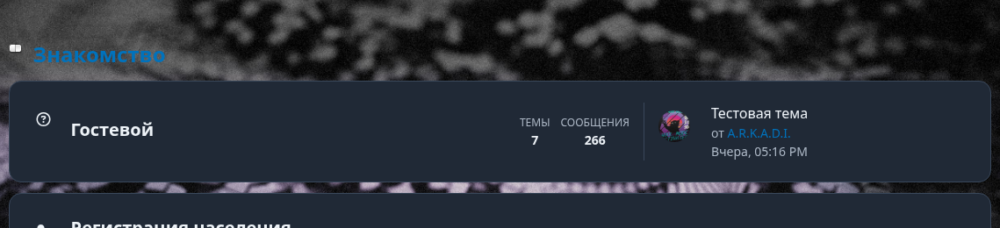
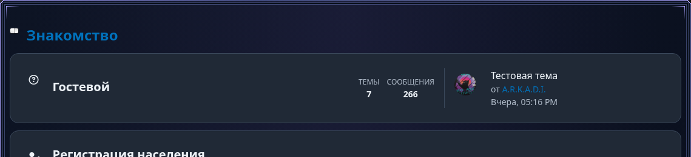

# ATF Ornate Frame — bugfix 0.29.7

Предыдущая реализация 0.29.6 не прошла приёмку. Ниже — диагностика действующего warprift.ru и исправление конкретной регрессии. Сервер/ACP не изменялись: проверка исправленного CSS выполнена его локальной подстановкой в Chromium поверх фактических страниц сайта.

## 1. Почему рамка исчезла

На действующей главной действительно загружен Theme stylesheet:

`https://warprift.ru/cache/themes/theme2/adaptivethemeframework.min.css?v=d97ce7ca6476c190`

В нём присутствуют правила компонента, но штатная `minify_stylesheet()` MyBB 1.8.40 (`admin/inc/functions_themes.php`) удаляет пробел перед `:`:

```css
/* File/source */
body.atf-active :is(.atf-ornate-frame, .pun.atf-page-shell, ...) { ... }
/* Фактически полученный Theme/minified */
body.atf-active:is(.atf-ornate-frame,.pun.atf-page-shell,...) { ... }
```

Второй selector требует совпадения с самим body, а не с дочерним main. В реальном браузере у `.atf-page-shell` и `.af-kb-page` получено `before.content = none`, `after.content = none`. Корень при этом обнулён прежним `background: transparent; border: 0; box-shadow: none`. Старая рамка KB уже удалена. Это подтверждённая причина, а не предположение о z-index.

Дополнительно текущая тема содержит более специфичный ID reset:

```css
#content { background: transparent; overflow: hidden; }
```

Он перекрывал прямой фон root при первой проверке исправления на настоящем DOM. В alias включён реальный `#content.atf-page-shell`, поэтому стандартный компонент перекрывает этот reset без глобальных `!important`.

Фильтр вложенности проверен на фактических ancestors пяти доступных страниц: их верхние контейнеры не исключаются. `*:is(...)` сохраняет descendant boundary после минификации. Вложенные KB/page roots по-прежнему не получают вторую рамку.

## 2. Где теперь рисуется рамка и fallback

- Root напрямую рисует тёмный градиент, внешний контур и четыре среза 6px через background layers. Даже принудительное отключение обоих псевдоэлементов оставляет внешний контур и фон.
- `::before` рисует только две внутренние линии; `::after` — восемь световых штрихов. У обоих `z-index: 0`, `pointer-events: none`; непрозрачной заливки поверх содержимого нет.
- При отсутствии поддержки enhancement остаются обычная `border: 1px solid var(--atf-frame-edge)` и полный тёмный background. У page root удалён прежний отдельный unconditional reset в transparent/border:0.
- `clip-path`, mask, transform и containment к контентному root не применяются. `overflow: visible` перекрывает `#content` темы. Внешние углы не округляются.
- Семь публичных переменных и утверждённые цвета сохранены. Postbit, внутренние карточки, AdvancedAppearance, AdvancedElementTheme и ядро MyBB не менялись.

## 3. Доставка Theme / File и установка

Источник остаётся в существующем глобальном design-system stylesheet ATF, с прежними manifest permissions/attachments. Новых bundles и runtime нет. Manifest и bootstrap согласованы на 0.29.7.

Проверено:

1. Загружены реальный HTML, Theme `.min.css` и физический File `.css` с warprift.ru. Компонент есть в обоих; ошибка selector находится в минифицированной версии.
2. Новый файл пропущен через настоящую `minify_stylesheet()` из официального тега MyBB `mybb_1840`, отдельно скачанную в work/. Ядро форума не редактировалось. Браузерный regression использует те же преобразования, включая удаление пробела перед `:`.
3. На фактических страницах локально заменены ответы существующих core Theme CSS URLs новым minified CSS, сохранив остальные стили и порядок. Отдельно проверен File/source с заменой core href на физический URL `assets/adaptivethemeframework.css?v=0.29.7`.
4. Производственный `af_register_theme_stylesheet()` проверен с настоящими старым/новым CSS и DB double существующего sync-теста: обычный sync заменяет неизменённый установленный seed; ручной CSS сохраняется. Переключение Theme → File снимает attachment, File → Theme восстанавливает его; пользовательские байты не меняются.
5. Проверены существующие URL builders: Theme cache URL использует hash содержимого, при недоступном cache — `css.php?stylesheet=SID&v=HASH`; File URL использует `filemtime`. Версия аддона сама по себе не обновляет сохранённый Theme CSS.

**Необходимое действие администратора:** обновить файлы до этого коммита, выполнить штатное обновление ATF и обычный Sync Theme stylesheets в ACP для ATF / активной темы, затем обновить страницу без browser cache. Это регенерирует минифицированный cache и его URL. Не выполнять Force Resync для пользовательского stylesheet.

Если design-system stylesheet отмечен `Customized` / `customized_seed_changed`, обычный sync намеренно его не перезаписывает. Администратору нужно вручную перенести исправленный компонент из физического CSS в этот Theme stylesheet, сохранив свои изменения. Временная альтернатива — переключить только этот источник в File через ACP; сохранённый пользовательский CSS не удаляется. Удалённый ACP и его БД в этой сессии недоступны; синхронизация production не выполнялась.

## 4. Какие реальные страницы проверены

Chromium, гостевой доступ, реальные HTML/DOM и остальные CSS действующего warprift.ru. Новое оформление — **локальная CSS-подстановка**, не опубликованное состояние production.

| Страница | Фактический root | Результат локальной подстановки |
| --- | --- | --- |
| `/` (`/index.php` перенаправляет сюда) | `main.pun.atf-page-shell.atf-index` | Фон, контур и орнамент видны в Theme/minified и File/source |
| `/forumdisplay.php?fid=3` | `main.pun.atf-page-shell.atf-forumdisplay` | То же |
| `/showthread.php?tid=14` | `main.pun.atf-page-shell.atf-thread` | То же; отдельные postbit не получают рамку |
| `/kb.php` | `div.af-kb-page` | То же |
| `/characters.php` | `div.af-kb-page.af-kb-page--characters` | То же |
| `/member.php?action=profile&uid=1` | Гостю показано «Упс! Нет доступа» | Профиль установленного форума визуально не подтверждён |
| `/usercp.php` | Гостю показано «Упс! Нет доступа» | UCP установленного форума визуально не подтверждён |

Для пяти доступных roots до подстановки: background image отсутствует, `before/after.content = none`. После подстановки: root background содержит градиенты/контур, `before/after.content = ""`, `z-index = 0`, `clip-path = none`, `overflow = visible`. На верхнем внешнем контуре прочитан цвет около `rgb(162,155,243)` вместо фоновых серых пикселей прежней страницы. Сохранены и осмотрены скриншоты главной и KB; computed styles проверены дополнительно, не вместо пикселей.

Фактическая главная до исправления:



Та же страница с локально подставленным исправленным Theme CSS:



На viewport 375px контур/фон также рисуются на пяти доступных страницах. **Приёмка общей мобильной раскладки не подтверждена:** действующая тема имеет ancestor `.wrapper` с `min-width:970px` и внешний wrapper с `min-width:990px`; документ шире viewport. Эти правила не относятся к компоненту рамки и в bugfix не изменялись. Правый край широкой страницы требует горизонтального scroll. В адаптивных контейнерах локального regression рамка не создаёт переполнения.

## 5. Проверки и изменённые файлы

- Существующий `tests/atf_ornate_frame_browser.cjs` расширен проверкой MyBB minification и настоящего `#content` reset. Выполнен в File и Theme режимах, с baseline-сравнением presentation postbit. Проверены четыре угла по пикселям, фон без псевдоэлементов, обычный fallback, вложенные roots, длинный текст, popover, fixed overlay и ATF off. Все проверки прошли.
- Существующий `tests/stage6_atf_browser.cjs`: sticky/sidebar, добавление postbit, lazy modal open/close и mobile runtime.
- PHP lint, `node --check`, `git diff --check` выполнены. PHP CLI проверок — 8.4.24; PHP 8.5 production не запускался из этой среды.

Изменены: ATF `assets/adaptivethemeframework.css`, `manifest.php`, версия в `adaptivethemeframework.php`; существующий browser regression; этот Summary и два диагностических PNG. Бизнес-логика, шаблоны установленных страниц и пользовательские Theme stylesheets не переписывались.
